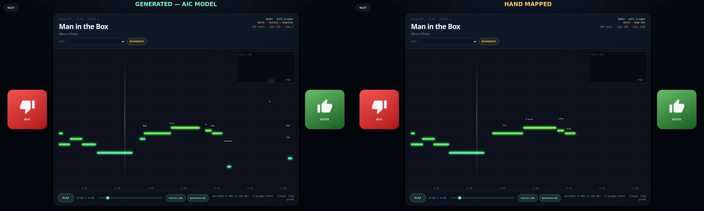
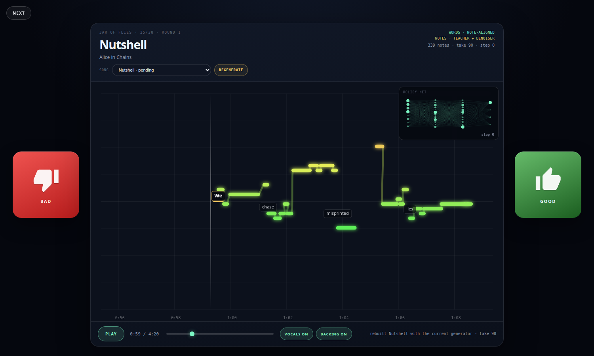

# KaraokeMachine Autogenerator

A standalone neural autogenerator for KaraokeMachine maps. It uses the app's
dense vocal-melody teacher, a denoiser trained on one explicitly approved
finished map plus public USDB note tracks, and thumbs-up / thumbs-down grades.
It generates candidates for the Alice in Chains albums **Dirt**, **Facelift**,
and **Jar of Flies**.

This folder is independent of the Rust app. Nothing here is compiled into
KaraokeMachine.

## Data policy

**Note-policy training data:** only maps listed in [`approved.json`](approved.json).

**Teacher training data:** the approved map plus the public USDB note tracks
documented below. No draft map is ever read as a teacher chart, training label,
or generation seed; teacher charts are regenerated from the vocal stem.

The allowlist contains exactly one finished map:

- **Man in the Box** — Alice in Chains — `yt-H1i5HaQV9ck/maps/Legacy.json`

Salve Regina, Tequila, and every draft map are **not** used as note-policy
training data. The loader rejects drafts and never auto-scans the library for
training data. Public karaoke timing pages and LRCLIB synced lyric lines are
separate calibration inputs; they are not maps and do not promote a draft.

**Generation targets:** [`targets.json`](targets.json) lists the other 30 Alice
in Chains songs from Dirt, Facelift, and Jar of Flies. Man in the Box is
explicitly excluded because it already has a finished map. Draft maps on those
targets are ignored; the model generates a new candidate from the vocal audio.

## What it does

1. Decodes the vocal/guide track with `ffmpeg`.
2. Extracts frame-level YIN pitch, volume, spectral onset and lyric-alignment
   features.
3. Runs the app's dense melody extractor over the isolated vocal stem. Its
   stable-pitch segments are the teacher chart.
4. A neural denoiser scores each teacher note, chooses a target density, and
   predicts small pitch, onset and duration corrections. When no teacher model
   is available, the older onset-proposal policy is the fallback.
5. Ensures every timed lyric word gets at least one nearby teacher or audio
   note, so quiet words are not dropped.
6. Writes a playable draft map with notes, explicit ribbon links, lyric lines,
   and note-driven placed words. For songs with public karaoke timing data, a
   second small network calibrates the word times against those public
   versions. Sunshine uses public line-level LRCLIB timing, so only its line
   placement is calibrated.
   - `assets/songs/<song-id>/maps/AI-Candidate.json`
   - an archive copy under `automap/candidates/<song-id>/`
7. Plays the map in the grading window. A thumbs-down updates the policy and
   generates another candidate for the same song; a thumbs-up updates the
   policy and advances to the next song.

The queue is round-robin: each successful song advances the target, then the
queue wraps around for another round with the improved policy.

## Setup

Python 3.10+ and `ffmpeg` are required. This checkout already has a working
virtual environment at `automap/.venv`.

```bash
cd automap
python3 -m venv .venv
.venv/bin/pip install -r requirements.txt
```

For CPU-only PyTorch:

```bash
.venv/bin/pip install --index-url https://download.pytorch.org/whl/cpu torch
```

## Train

```bash
cd automap
.venv/bin/python -m automap train --epochs 60
```

The first run extracts and caches the vocal analysis. Training prints how many
approved notes have a matching onset proposal, full-song reconstruction note
F1, held-out candidate F1, and the checkpoint path.

The one-song policy checkpoint is `automap/checkpoints/note_policy.pt`. It is
kept as a fallback and for the original grading loop.

## Teacher-guided note generation

The strongest prior is already in the app: `tools/analyze_vocals.py` tracks the
isolated vocal stem and segments it into a dense melody chart. `automap` runs
that teacher on each target, caches the result under `cache/suggestions/`, and
trains a **note denoiser** over it instead of asking a small policy to invent
onsets from an arbitrary candidate grid.

```bash
cd automap
.venv/bin/python -m automap train-teacher
```

Training pairs the teacher chart with the hand-mapped **Man in the Box** chart
and **21 public USDB note tracks** matched across the local imports (AIC,
Backstreet Boys, Creed, ABBA, Eagles, George Michael, Pearl Jam, Wham!,
Lynyrd Skynyrd). The registry is `usdb_matches.json`; each match has an
audio-verified note offset.

Two checkpoints are used:

- `checkpoints/teacher_policy.pt` — broad 21-song USDB model, used for
  non-AIC artists. Pitch correction is disabled because the teacher already
  carries the local pitch; only selection and duration are refined.
- `checkpoints/teacher_policy_aic.pt` — AIC-specialized model, used for
  Alice in Chains songs without a public note track.

The broad model scores mean F1 **0.498**, median **0.553** across the 21 matched
note charts. Examples: My Sacrifice 0.694, Man in the Box 0.641, Hotel
California 0.631, Careless Whisper 0.630, Black 0.623.

AIC specialist (pitch correction disabled):

| Reference chart | Teacher notes | Generated notes | Note F1 | Raw teacher F1 |
| --- | ---: | ---: | ---: | ---: |
| Man in the Box | 514 | 154 | **0.734** | 0.375 |
| Them Bones | 326 | 80 | **0.392** | 0.204 |
| We Die Young | 304 | 85 | **0.625** | 0.333 |
| No Excuses | 370 | 129 | **0.356** | 0.240 |
| Would? | 371 | 121 | **0.492** | 0.336 |
| Nutshell | 339 | 104 | **0.463** | 0.235 |

For the 40 non-USDB local songs that produce notes (Whale & Wasp is
instrumental), the teacher path produces a median 216 notes and 37 ribbons;
median exact-pitch agreement with the local vocal is 60.8%, within one semitone
77.4%, and 89.1% of note onsets land on voiced frames. This is an audio-alignment
check, not a hand-map ground truth benchmark; those songs still need grading.



The public note tracks now use a **separate audio-verified note offset**, not
the lyric-word offset. This fixes the large intro mismatch on Them Bones
(`note_offset = 3.75 s`). Public-note and teacher maps place lyric words on the
generated notes and generate explicit ribbon links for legato runs, so the
stage does not fall back to disconnected notes.

## Train word timing against public karaoke versions

```bash
cd automap
.venv/bin/python -m automap train-words
```

This fetches the public USDB UltraStar timing pages for four of the target
songs — **Them Bones**, **We Die Young**, **No Excuses**, and **Would?** — plus
the public LRCLIB synced lyric lines for **Sunshine**, and trains the
word-placement calibration network. Only timing/text pages are fetched; no
karaoke audio is downloaded. Raw pages stay in the ignored `cache/karaoke/` and
`cache/lrclib/` folders.

The committed calibration result is in `word_metrics.json`:

| Song | Targets | Baseline error | Calibrated error |
| --- | ---: | ---: | ---: |
| Them Bones | 100 words | 683 ms | **25.7 ms** |
| We Die Young | 89 words | 801 ms | **25.6 ms** |
| No Excuses | 60 words | 1349 ms | **31.7 ms** |
| Would? | 127 words | 814 ms | **26.8 ms** |
| Sunshine (line-level) | 36 lines | 0 ms\* | **2.8 ms** |
| **Overall word sources** | **376 words** | **861 ms** | **27.0 ms** |

\* Sunshine's local lyric lines were imported from the same public LRCLIB
version and shifted by 0.29 s to match the local audio, so the line-start
baseline is already aligned. Its reported error is **line-level**, not
word-level: LRCLIB does not provide word or note timestamps. Sunshine's word
pills follow its generated note track; its public line boundaries are used for
line placement, not as independent word timestamps.

The word model is fitted to those public versions; it is a calibration model
for those songs, not a claim of held-out generalization. Teacher and public-note
maps place words directly on their note track; the old policy fallback uses the
song's synced lyric timings. The UI shows `WORD TIMING · USDB · N ms` for a
word-level calibrated song, `LINE TIMING · LRCLIB · N ms` for Sunshine, and
`WORD TIMING · LYRICS` otherwise.

The calibration sources are listed in `word_offsets.json`; the side-by-side
public timing pages are linked there.

**Note tracks** for the 21 matched USDB songs are rebuilt from the public
UltraStar note lines rather than the one-song neural policy. Their note times use the audio-verified note offset, and
each pitch is placed in the octave nearest the local vocal track. The UI labels
them `NOTES · USDB CALIBRATED`. Sunshine and the other targets use the teacher +
denoiser track and show `NOTES · TEACHER + DENOISER`. Their words are placed on
those notes and their legato runs get explicit ribbon links.

## Grade in the UI

```bash
cd automap
./start-ui.sh
# or: .venv/bin/python -m automap ui
```

This starts `http://127.0.0.1:8765/` and opens it in your browser.



The window shows a **sidescrolling preview** of about 14 seconds around the
playhead, so the notes are readable instead of squeezing the whole song into one
view.

The map's placed lyric words are drawn as pills at their mapped times and
vertical positions. The active word gets a gold underline. For teacher and
public-note maps, words are placed on the generated note track; the old policy
fallback uses the word-timing calibration network or the song's synced lyrics.
This is the same `placedWords` data the KaraokeMachine stage uses, so what you
grade is what the app plays.

The top-right **POLICY NET** panel shows the live policy network, model step,
last loss and the normalized weight delta after a grade. A grade pulses the
network, highlights changed nodes in gold, and increments the `take N` counter.

A **SONG** picker above the preview lists all 30 targets grouped by album.
Songs with an ungraded candidate are marked **pending**; choosing one resumes
that candidate instead of throwing it away.

The transport has:

- **PLAY / PAUSE**
- a whole-song seek bar
- **VOCALS ON/OFF**
- **BACKING ON/OFF**
- current time and queue status

Click or drag the note preview to seek within the visible window. Use the seek
bar to jump anywhere in the song.

**Grades and queue**

- Red **BAD** thumbs-down gives reward `-1` and generates another candidate for
  the same song.
- Green **GOOD** thumbs-up gives reward `+1` and advances to the next song.
- **NEXT** skips the current candidate and moves to the next song without
  updating the model.
- **REGENERATE** discards the current candidate and rebuilds this song with the
  active generator. Use it when an old candidate is still lingering from before
  the teacher pipeline was installed. The old archive is kept; the queue position
  is not advanced.
- The model is saved after every grade.

Keyboard shortcuts:

| Key | Action |
| --- | --- |
| `←` / `↓` | Bad map |
| `→` / `↑` | Good map |
| `N` | Skip to the next song |
| `R` | Regenerate the current song |
| `Space` | Play / pause |

If KaraokeMachine is open, restart it after a new candidate is written to load
`AI-Candidate` from that song's map picker. The browser UI is the intended
grading surface.

## Saving progress and resuming

Everything needed to continue later is saved automatically:

- the neural checkpoint after **every grade**
- `state/queue.json`, which stores the current target, round, next song, and
  per-song generated/graded/skipped counts
- every waiting candidate under `state/pending-<song-id>.npz`
- your playback position every 5 seconds and when you close the page

Passing `--song` or using the SONG picker switches targets immediately. A song
that already has a waiting candidate resumes that candidate; otherwise a new
one is generated.

Close the browser or stop the server at any time. Run `./start-ui.sh` again and
it resumes the waiting candidate at the saved position. After a grade it either
retries the same song (BAD) or continues with the next song (GOOD). Browser
disconnects during a long generation are ignored cleanly; the server still
finishes and saves the candidate.

To start at a specific target instead of resuming the queue:

```bash
.venv/bin/python -m automap ui --song yt-zTuD8k3JvxQ
```

## Other commands

```bash
cd automap

# List local songs, audio availability, map counts, training and target status.
.venv/bin/python -m automap songs

# Generate one candidate for the first target without the browser UI.
.venv/bin/python -m automap generate --seed 1

# Generate for one specific target.
.venv/bin/python -m automap generate --song yt-zTuD8k3JvxQ --seed 1

# Grade in the terminal and keep generating candidates.
.venv/bin/python -m automap grade --song yt-zTuD8k3JvxQ

# Train the word-timing calibration against public USDB karaoke timings.
.venv/bin/python -m automap train-words

# Train the teacher-note denoiser against the hand map and public note tracks.
.venv/bin/python -m automap train-teacher

# Train the explicit ribbon-link policy from the hand map.
.venv/bin/python -m automap train-ribbons
```

Useful UI options:

```bash
.venv/bin/python -m automap ui --port 8770 --no-browser
.venv/bin/python -m automap ui --song <song-id>
```

## How grading works

The active model is the teacher-note denoiser: a Bernoulli keep policy over
teacher notes plus Gaussian distributions for pitch, onset and duration
corrections. The older onset-proposal policy remains the fallback and is what
the original `note_policy.pt` checkpoint contains.

- Grade 5 / `+` has reward `+1`.
- Grade 1 / `-` has reward `-1`.
- Grades 4 and 2 are `+0.5` and `-0.5`.
- Grade 3 is neutral.
- **NEXT** skips without a weight update.

Each update uses:

- REINFORCE with a moving-average reward baseline, scaled so one human grade has
  a visible effect
- entropy regularization
- a supervised replay anchor on the approved Man in the Box map, so the policy
  does not forget the only good example
- a live step/loss/weight-delta readout in the POLICY NET panel

Candidates are draft map files. Once a candidate is good enough, open it in the
KaraokeMachine editor and submit it like any other map.

## Files and artifacts

| Path | Purpose |
| --- | --- |
| `approved.json` | the only training allowlist |
| `targets.json` | the 30-song generation queue |
| `automap/audio.py` | ffmpeg decode, YIN pitch, RMS and onset analysis |
| `automap/candidates.py` | onset proposals and approved-map labels |
| `automap/model.py` | neural policy |
| `automap/train.py` | supervised training |
| `automap/generate.py` | candidate map writing and calibration |
| `automap/grade.py` | reward mapping and policy updates |
| `automap/karaoke.py` | public USDB timing fetch, word and note targets |
| `automap/word_model.py` | word-timing calibration network |
| `automap/note_calibration.py` | public note-track rebuilding and octave matching |
| `automap/teacher.py` | dense melody teacher, note denoiser and word coverage |
| `automap/ribbon_model.py` | learned explicit ribbon-link policy |
| `word_metrics.json` | committed calibration metrics and sources |
| `word_offsets.json` | committed per-song public timing offsets |
| `teacher_metrics.json` | committed broad teacher-denoiser metrics |
| `teacher_metrics_aic.json` | committed AIC-specialist metrics |
| `ribbon_metrics.json` | committed ribbon-policy metrics |
| `usdb_matches.json` | matched local/USDB note sources and offsets |
| `automap/queue.py` | target queue and persistent progress |
| `automap/ui.py` | local grading server, dual-audio streaming, queue session |
| `automap/ui_assets/` | the sidescrolling thumbs-up/down window |
| `cache/` | extracted audio, onset features and teacher charts (ignored) |
| `checkpoints/` | trained policies (ignored) |
| `candidates/` | archived generated maps (ignored) |
| `state/` | queue, pending candidate, playback position, feedback log (ignored) |

No audio is copied into this folder. The tool reads the licensed local library
and never embeds audio in a map.

## Known limitations

- The teacher denoiser is trained on one hand map plus 21 public note tracks.
  It generalizes the teacher's melody, but it is not a substitute for a hand
  pass. The grading loop is still how it adapts to the remaining songs.
- Word timing and public note tracks are calibrated against four USDB karaoke
  versions. Sunshine adds a fifth timing source, but it is **line-level only**
  (LRCLIB), so its individual word times are inferred from its note/line
  placement rather than a public word-level chart. The reported word-timing
  error is a fit to those versions, not a held-out generalization benchmark.
- Coverage notes are forced at timed words when the teacher/policy would
  otherwise leave a lyric line empty. They are a safety net, not a separate
  learned model.
- The target songs already have draft maps on disk, but those drafts are never
  read as teacher charts, training data, or generation seeds. Teacher charts are
  regenerated from the vocal stem.
- The generated map is a starting point, not a replacement for submitting a
  reviewed map.
