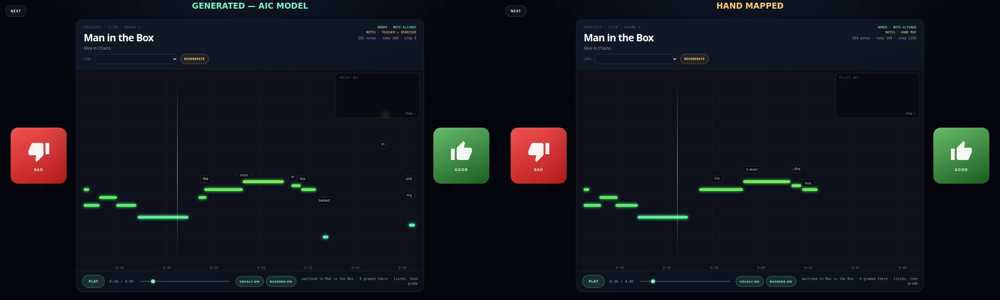

# Man in the Box: generated vs. hand map

Generated without listening, using the teacher chart plus the AIC-specialized
note denoiser. The hand reference is
`assets/songs/yt-H1i5HaQV9ck/maps/Legacy.json`.

| Metric | AIC model | Held-out model (MITB removed) | Hand map |
| --- | ---: | ---: | ---: |
| Notes | 185 | 178 | 184 |
| Matched notes | 126 | 65 | — |
| Note precision | 0.681 | 0.365 | — |
| Note recall | 0.685 | 0.353 | — |
| Note F1 | **0.683** | 0.359 | 1.000 |
| Matched onset MAE | **29 ms** | 70 ms | — |
| Pitch exactly equal | **80.2%** | 60.0% | — |
| Pitch within 1 semitone | **100%** | 100% | — |
| Duration ratio, median | **0.94×** | 0.90× | — |
| Placed words | 118 | 118 | 119 |
| Word-start MAE | 2134 ms | 2250 ms | — |
| Learned ribbon links | 54 | 41 | 69 |

The AIC model was trained on Man in the Box, so its 0.683 note F1 is a
training-set result. The held-out model, trained only on public USDB note
charts, scores 0.359. That gap is the real generalization gap and is why the
other songs still need grading/hand correction.

The note lane is close. The weak part is **word placement**: the hand map places
lyrics independently of the note track, while the generated map still attaches
each word to a note. That is the next training target. Ribbons now use the
learned link policy trained from the hand map, not only a fixed gap rule.

